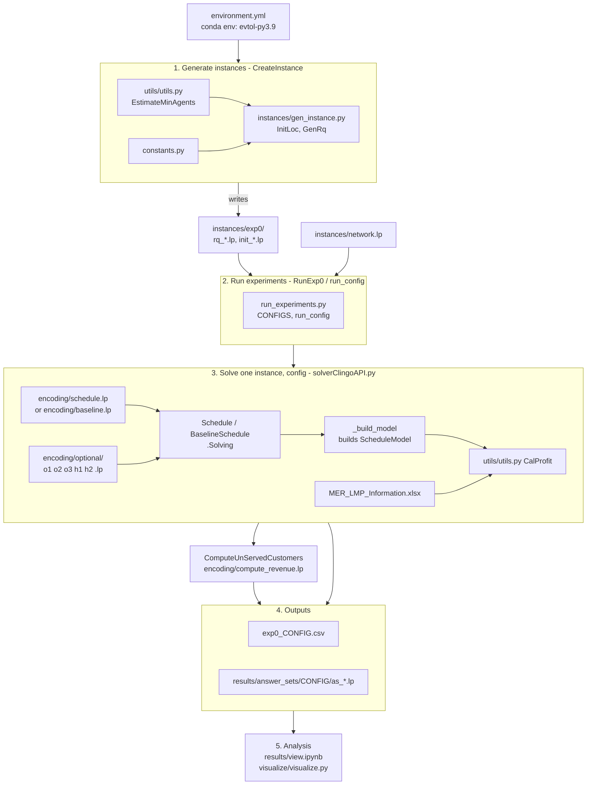

# Program Workflow

How the pieces fit together, from environment setup to the result tables and
figures. The entry point is `run_experiments.py`.

## Overview



## Step by step

### 0. Environment
| | |
|---|---|
| **Files** | `environment.yml` |
| **Action** | `conda env create -f environment.yml && conda activate evtol-py3.9` (clingo-dl needs Python 3.9). Run all commands from the repo root. |

### 1. Generate instances — `CreateInstance()`
| | |
|---|---|
| **Entry** | `run_experiments.py` → `CreateInstance()` |
| **Reads** | `constants.py` (vertiports, distances), via `utils/utils.py::EstimateMinAgents` (fleet/segment sizing) |
| **Uses** | `instances/gen_instance.py` → `InitLoc` (aircraft start locations + battery/capacity facts), `GenRq` (per-edge demand facts) |
| **Writes** | `instances/exp0/rq_ins*.lp` and `instances/exp0/init_ins*.lp` (5 samples × 6 demand sizes) |
| **Note** | The vertiport network `instances/network.lp` is static (optionally regenerated by `instances/gen_network.py`). |

### 2. Run experiments — `RunExp0()`
| | |
|---|---|
| **Entry** | `run_experiments.py` → `RunExp0()` (this is what `python run_experiments.py` runs) |
| **Drives** | For each `Config` in `CONFIGS` × each instance, calls `run_config(...)` |
| **Configs** | `Greedy, O1, O2, O3, H1, H2, O1H2, O2H2, O3H2` — each maps to optional `encoding/optional/*.lp` modules |

### 3. Solve one (instance, config) — `run_config()` → `solverClingoAPI.py`
| | |
|---|---|
| **Builds** | `_build_solver()` → `Schedule` (hybrid encoding) or `BaselineSchedule` (greedy) |
| **Reads (Schedule)** | `encoding/schedule.lp` + chosen `encoding/optional/{o1,o2,o3,h1,h2}.lp` + `instances/network.lp` + the instance's `rq_*.lp` / `init_*.lp` |
| **Reads (Greedy)** | `encoding/baseline.lp` + `instances/network.lp` + instance files |
| **Solves** | `.Solving()` runs clingo + clingo-dl in a subprocess (wall-clock `TIME_LIMIT`) |
| **Decodes** | `_build_model()` → `ScheduleModel` (flight path + dl timing); calls `utils/utils.py::CalProfit` |
| **Reads (CalProfit)** | `MER_LMP_Information.xlsx` (LMP price + MER emission tables) and `constants.py` → revenue, charging cost, emission cost, profit |

### 4. Metrics & outputs
| | |
|---|---|
| **Served %** | `ComputeUnServedCustomers()` grounds `encoding/compute_revenue.lp` against the flight path → unserved customers → `_served_pct()` |
| **Answer set** | `SaveAnswerSet()` → `results/answer_sets/<config>/as_<instance_id>.lp` (the `flight` + `dl` atoms, loadable) |
| **Result row** | served %, profit, runtime → appended to `exp0_<config>.csv` (and pickled `exp0_<config>.csv.pkl`) |

### 5. Analysis & visualization
| | |
|---|---|
| **Tables/plots** | `results/view.ipynb` reads the `exp0_*.csv` files → paper figures (`results/{profit,runtime,service_rate}.svg`) |
| **Trajectories** | `visualize/visualize.py` reads `results/trajectories.lp` → `visualize/all_agents_trajectory.svg` |

## Function call chain

Which function calls which, and in which file. (`module.py::function`.)

### Instance generation
```
run_experiments.py::CreateInstance()
└── for each demand size × sample:
    ├── utils/utils.py::EstimateMinAgents()         # fleet size + segment count
    ├── instances/gen_instance.py::InitLoc()        # writes init_*.lp (locations, battery, capacity)
    └── instances/gen_instance.py::GenRq()          # writes rq_*.lp   (per-edge demand)
```

### Experiment run
```
run_experiments.py::RunExp0()                       # python run_experiments.py
└── for each Config in CONFIGS × each instance:
    └── run_experiments.py::run_config()
        ├── _build_solver()                         # -> Schedule or BaselineSchedule
        │
        ├── solverClingoAPI.py::Schedule.Solving()  # subprocess + time limit
        │   └── _solving_worker_static()            # (BaselineSchedule overrides this)
        │       ├── _read_program()                 # concat encoding + optional + network + instance
        │       ├── clingo ground + solve (clingo-dl)
        │       └── _build_model() -> ScheduleModel
        │           └── utils/utils.py::CalProfit()
        │               ├── _load_price_tables()    # MER_LMP_Information.xlsx
        │               ├── _parse_schedule()       # flight + dl atoms -> per-step data
        │               ├── _recompute_timing()     # battery / charge / departure-arrival
        │               └── _add_charging_and_emission_costs()
        │                   └── _charging_window_prices()
        │
        ├── run_experiments.py::SaveAnswerSet()     # -> results/answer_sets/<config>/as_*.lp
        ├── solverClingoAPI.py::ComputeUnServedCustomers()   # grounds compute_revenue.lp
        │   └── _read_program()
        ├── _served_pct()                           # served %
        └── _append_csv()                           # -> exp0_<config>.csv
```

### Key functions

| Function (file) | Role in the workflow |
|---|---|
| `CreateInstance` (run_experiments.py) | Generate the exp0 benchmark instances |
| `EstimateMinAgents` (utils/utils.py) | Minimum fleet size / segment count for a demand |
| `InitLoc`, `GenRq` (instances/gen_instance.py) | Write `init_*.lp` and `rq_*.lp` facts |
| `RunExp0` (run_experiments.py) | Top-level loop over configs × instances |
| `run_config` (run_experiments.py) | Solve one (instance, config), record + save |
| `_build_solver` (run_experiments.py) | Pick `Schedule` (hybrid) vs `BaselineSchedule` (greedy) |
| `Schedule.Solving` (solverClingoAPI.py) | Run the encoding in a time-limited subprocess |
| `_read_program` (solverClingoAPI.py) | Concatenate encoding + optional + network + instance files |
| `_build_model` (solverClingoAPI.py) | Decode a clingo model into a `ScheduleModel` |
| `CalProfit` (utils/utils.py) | Revenue, charging cost, emission cost, profit |
| `ComputeUnServedCustomers` (solverClingoAPI.py) | Served-customer count via `compute_revenue.lp` |
| `SaveAnswerSet` (run_experiments.py) | Persist the final answer set (`flight` + `dl` atoms) |
| `RunSingleExp0` (run_experiments.py) | Run a single (instance, config) — same core as `run_config` |

## File roles at a glance

| File / dir | Role |
|---|---|
| `run_experiments.py` | Entry point: instance generation + experiment loop |
| `solverClingoAPI.py` | Solving API (`Schedule`, `BaselineSchedule`, `ScheduleModel`, `ComputeUnServedCustomers`) |
| `constants.py` | Single source of truth: vertiports, distance matrix, physical/cost constants |
| `utils/utils.py` | `CalProfit` (revenue/cost accounting), `EstimateMinAgents` (fleet sizing) |
| `instances/gen_instance.py` | `InitLoc` / `GenRq` — generate aircraft and demand facts |
| `instances/gen_network.py` | Generate the vertiport network facts (optional) |
| `instances/network.lp` | Network facts: edges, distances, flight/charge times |
| `instances/exp0/` | Benchmark instances (`rq_*.lp`, `init_*.lp`) |
| `encoding/schedule.lp` | Core hybrid ASP encoding (routing + clingo-dl timing) |
| `encoding/baseline.lp` | 1-segment look-ahead greedy encoding |
| `encoding/optional/*.lp` | Objective (`o1/o2/o3`) and heuristic (`h1/h2`) modules |
| `encoding/compute_revenue.lp` | Served-customer / revenue computation |
| `encoding/baseline_py.py` | Standalone pure-Python greedy (not used by `RunExp0`) |
| `MER_LMP_Information.xlsx` | Time/location price (LMP) and emission (MER) tables |
| `visualize/` | Trajectory plotting |
| `results/` | Result CSVs, figures, and saved answer sets |
